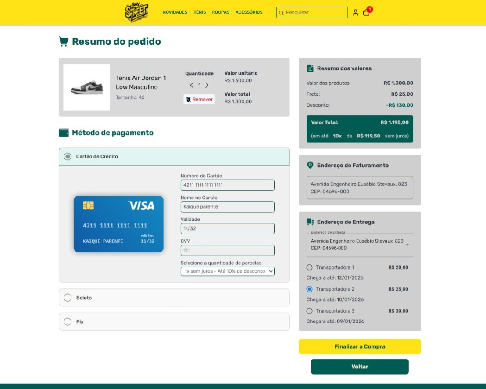

# 🛒 E-commerce Full Stack  

  
 

Este projeto é um sistema completo de **E-commerce** desenvolvido com foco em escalabilidade, boas práticas e experiência do usuário. Ele permite que clientes realizem cadastro, login, navegação por produtos, adição ao carrinho, cadastro de endereços e finalização de pedidos com pagamento simulado.  

Além disso, há um **backoffice administrativo** para gestão de produtos, usuários e pedidos.  

### 🎬 **Vídeo Completo**: [aqui.](https://nodejs.org/)

---

## 🚀 Tecnologias Utilizadas  

### **Frontend**  
- [Next.js](https://nextjs.org/) – Framework React para SSR/SSG  
- [Styled Components](https://styled-components.com/) – Estilização com CSS-in-JS  
- [React Credit Cards](https://www.npmjs.com/package/react-credit-cards-2) – Formulário interativo para cartões de crédito  
- [CoreUI](https://coreui.io/) – Componentes prontos para dashboards  
- [NextAuth.js](https://next-auth.js.org/) – Autenticação de usuários (clientes e backoffice)  

### **Backend**  
- [Spring Boot](https://spring.io/projects/spring-boot) – API REST com Java  
- [JPA / Hibernate](https://hibernate.org/) – Mapeamento objeto-relacional (ORM)  
- **DTO (Data Transfer Object)** – Transferência de dados entre camadas de forma segura e otimizada  
- **Design Patterns** – Aplicação de padrões como Singleton, Facade, Strategy, entre outros  
- **GlobalExceptionHandler** – Tratamento centralizado de exceções para respostas padronizadas  
- **Validações de segurança e autenticação**  

### **Infraestrutura**  
- [Cloudinary](https://cloudinary.com/) – Armazenamento e gestão de imagens de produtos  
- [Azure Database](https://azure.microsoft.com/products/azure-sql/) – Banco de dados hospedado na nuvem  
- [Selenium](https://www.selenium.dev/) – Testes automatizados de fluxo do usuário  

## Agradecimentos 🙏
Estou ansioso para compartilhar com vocês sobre outros projetos que estou trabalhando e continuar explorando novas possibilidades!

Obrigado pelo apoio e até a próxima! 👋🚀

## :memo: Licença

Este projeto está licenciado sob uma [Licença Proprietária](LICENSE). 📜
